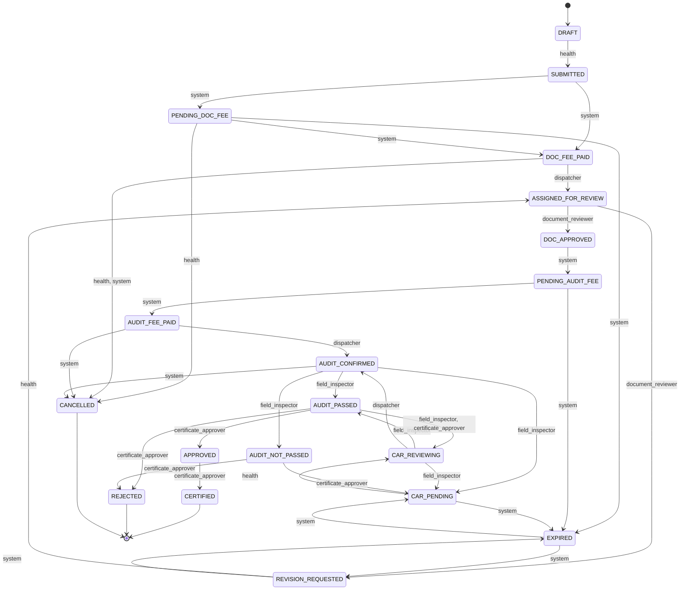

<!-- สร้างโดย scripts/docs/generate-architecture-diagrams.js ห้ามแก้ด้วยมือ -->

# วงจรสถานะคำขอ

ที่มา: `WORKFLOW_STATES`, `ALLOWED_TRANSITIONS`, `ROLE_TRANSITIONS` ใน `apps/backend/services/workflow-transition-service.js` · ป้ายบนเส้น = บทบาทที่เดินเส้นนั้นได้

