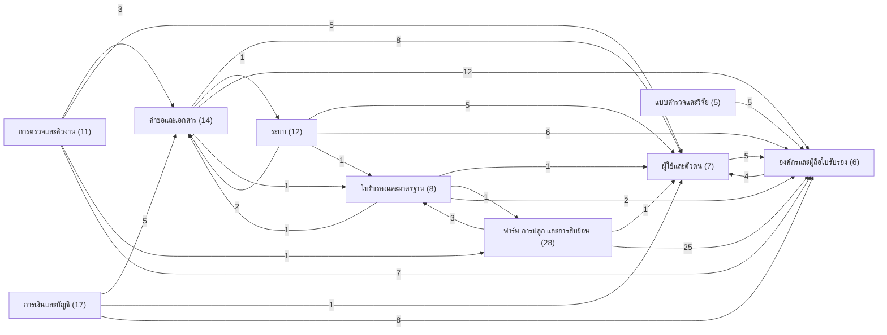
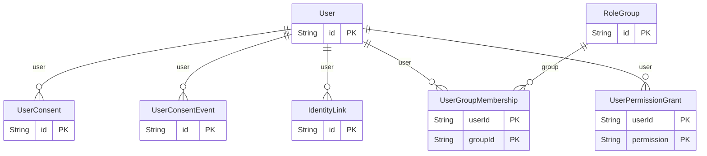
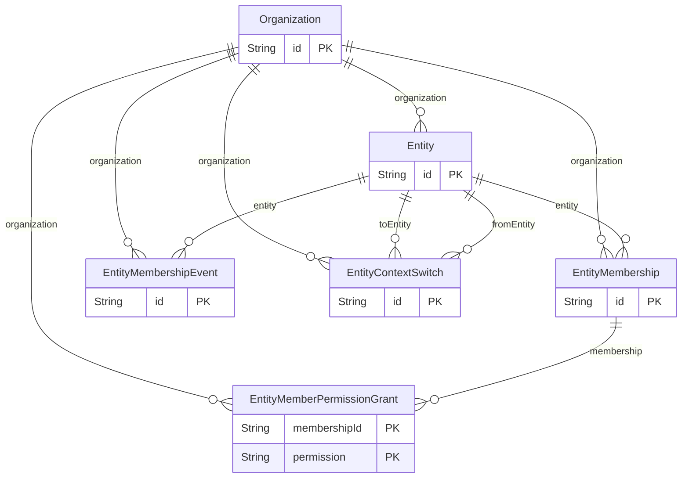
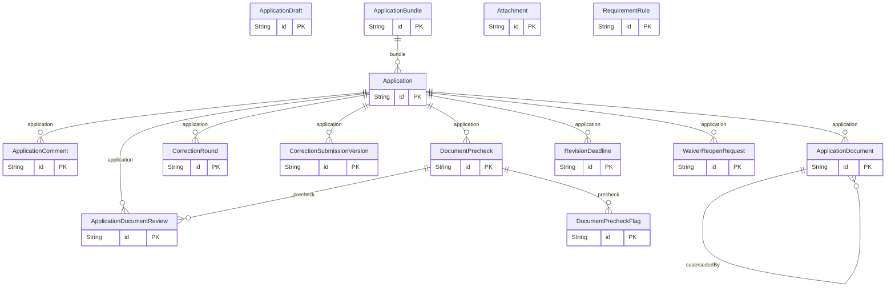
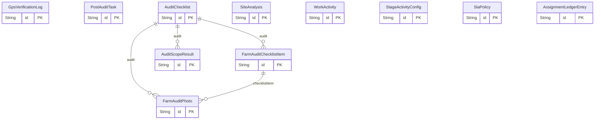
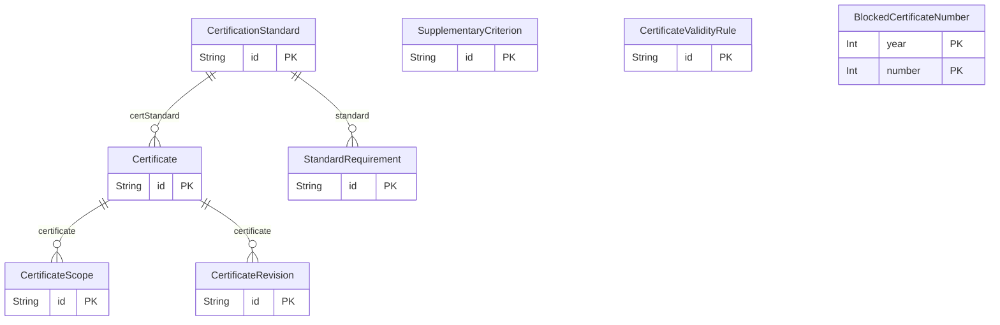
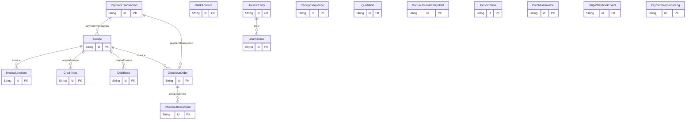
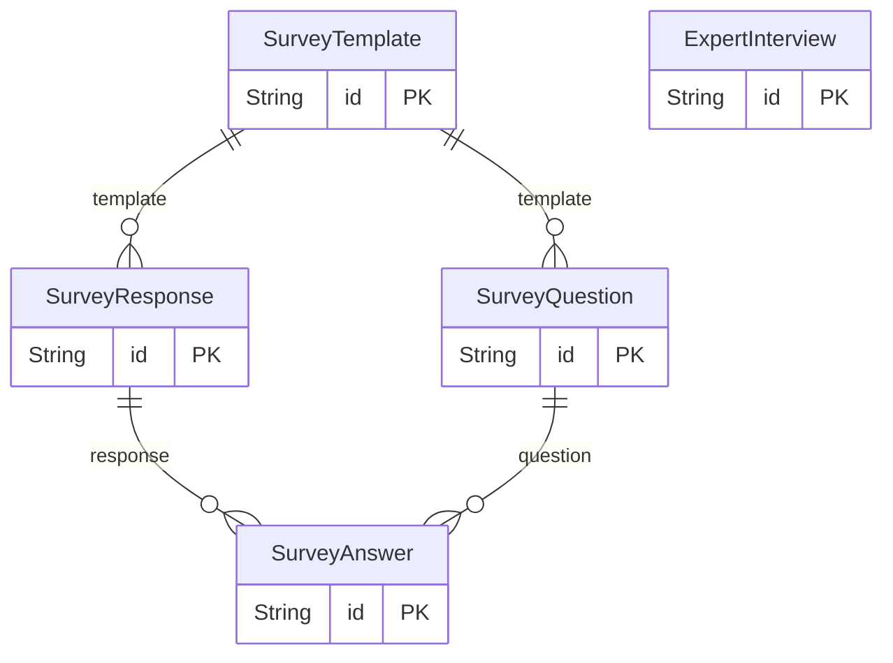
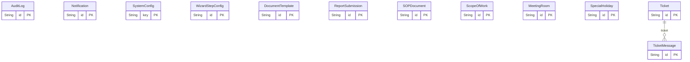

<!-- สร้างโดย scripts/docs/generate-architecture-diagrams.js ห้ามแก้ด้วยมือ -->

# แผนภาพข้อมูลตามกลุ่มโดเมน

ที่มา: `apps/backend/prisma/schema/*.prisma` · การจัดกลุ่ม: ตาราง arch:model-groups ใน `docs/architecture/README.md` · ในกล่องแสดงเฉพาะคีย์หลัก (PK) · เส้น = foreign key (ฝั่งที่มี `@relation(fields:)`)

## ความสัมพันธ์ข้ามกลุ่ม

## ผู้ใช้และตัวตน

## องค์กรและผู้ถือใบรับรอง

## คำขอและเอกสาร

## การตรวจและคิวงาน

## ใบรับรองและมาตรฐาน

## การเงินและบัญชี

## ฟาร์ม การปลูก และการสืบย้อน

```mermaid
erDiagram
  Farm {
    String id PK
  }
  Plot {
    String id PK
  }
  TrainingRecord {
    String id PK
  }
  WaterSource {
    String id PK
  }
  GrowingMedium {
    String id PK
  }
  SeedSource {
    String id PK
  }
  FertilizerRecord {
    String id PK
  }
  ControlledEnvironment {
    String id PK
  }
  PlantingCycle {
    String id PK
  }
  PlantingCyclePlot {
    String id PK
  }
  CareLog {
    String id PK
  }
  CultivationLog {
    String id PK
  }
  HarvestBatch {
    String id PK
  }
  DryingTemperature {
    String id PK
  }
  DryingHumidity {
    String id PK
  }
  DryingDarkRoom {
    String id PK
  }
  CuringProcess {
    String id PK
  }
  PackagingDetail {
    String id PK
  }
  DryingProcess {
    String id PK
  }
  BatchLabResult {
    String id PK
  }
  Lot {
    String id PK
  }
  TraceQrSecurity {
    String id PK
  }
  TraceQrScan {
    String id PK
  }
  ConsumerFeedback {
    String id PK
  }
  PlantSpecies {
    String id PK
  }
  PartnerAccessLog {
    String id PK
  }
  HerbSpecies {
    String id PK
  }
  HerbKnowledgeEntry {
    String id PK
  }
  HarvestBatch ||--o{ BatchLabResult : harvestBatch
  Farm ||--o{ PlantingCycle : farm
  PlantSpecies ||--o{ PlantingCycle : plantSpecies
  Plot ||--o{ PlantingCycle : plot
  PlantingCycle ||--o{ PlantingCyclePlot : cycle
  Plot ||--o{ PlantingCyclePlot : plot
  PlantingCycle ||--o{ CareLog : cycle
  PlantingCycle ||--o{ CultivationLog : cycle
  Plot ||--o{ CultivationLog : plot
  Farm ||--o{ TrainingRecord : farm
  Farm ||--o{ Plot : farm
  Plot ||--o{ WaterSource : plot
  PlantingCycle ||--o{ GrowingMedium : cycle
  PlantingCycle ||--o{ SeedSource : cycle
  PlantingCycle ||--o{ FertilizerRecord : cycle
  Plot ||--o{ ControlledEnvironment : plot
  PlantingCycle ||--o{ HarvestBatch : cycle
  Farm ||--o{ HarvestBatch : farm
  PlantSpecies ||--o{ HarvestBatch : plant
  Farm ||--o{ DryingTemperature : farm
  Farm ||--o{ DryingHumidity : farm
  Farm ||--o{ DryingDarkRoom : farm
  Farm ||--o{ CuringProcess : farm
  HarvestBatch ||--o{ PackagingDetail : batch
  PlantingCycle ||--o{ DryingProcess : cycle
  HarvestBatch ||--o{ DryingProcess : batch
  HerbSpecies ||--o{ HerbKnowledgeEntry : species
  HarvestBatch ||--o{ Lot : batch
  TraceQrSecurity ||--o{ TraceQrScan : qrSecurity
```

## แบบสำรวจและวิจัย

## ระบบ

